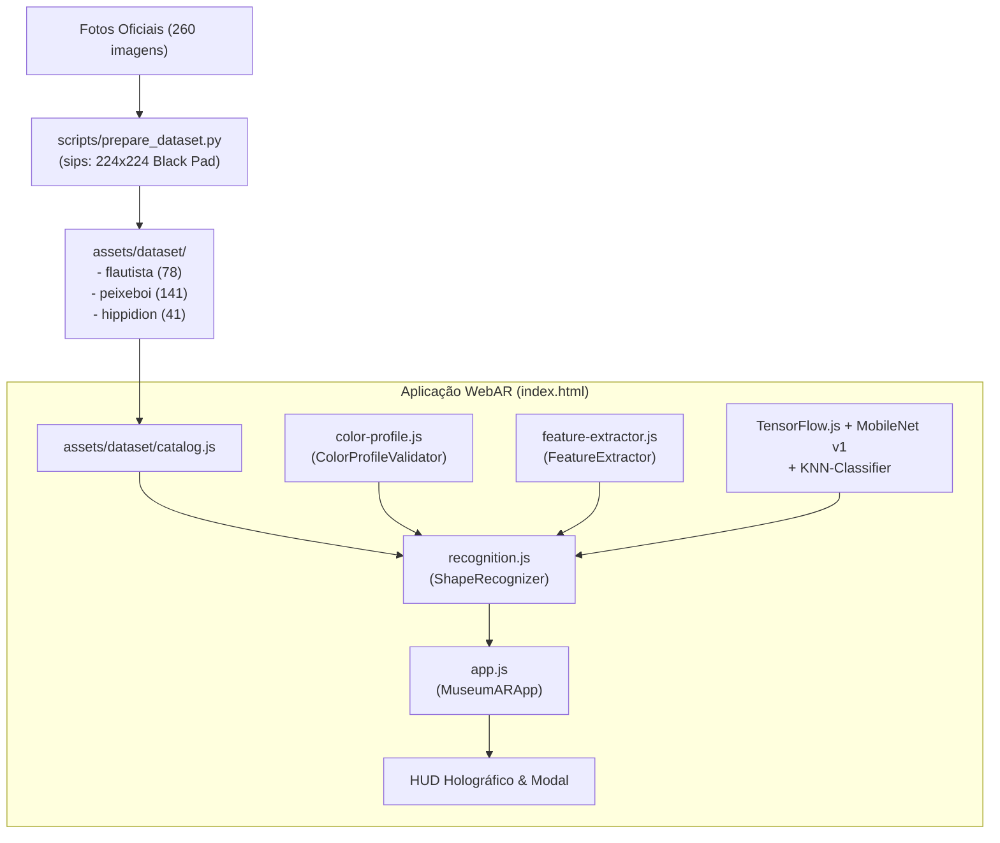

# Map of Content (MOC) - MUSARQ AR

Índice central de arquitetura e visão computacional da experiência WebAR do Museu.

---

## 🗺️ Mapa de Componentes & Arquitetura

---

## 📦 Módulos do Sistema

- [[color-profile]]: Validação de plausibilidade cromática em espaço de cor HSL, calibrada pelas estatísticas empíricas das fotos físicas do acervo.
- [[feature-extractor]]: Convolução com operador Sobel 3x3 para densidade de bordas e cálculo de contorno periférico radial de 24 pontos.
- [[recognition]]: Orquestrador central que executa MobileNet (v1, alpha 0.50), infere a classe através de KNN ponderado (k=5) e aplica fusão multi-modal (Neural + HSL + Bordas).
- [[app]]: Controlador da interface, renderização do scanner holográfico no canvas, reprodução de narração em áudio e abertura do modal informativo do acervo.
- [[test]]: Verificador visual para teste unitário e diagnóstico em lote de fotos.
- [[trainer]]: Ferramenta de treinamento neural em tempo de execução com exportação de tensores.

---

## 🎯 Assinaturas das Peças do Acervo

1. **Flautista**:
   - Classificação: Crânio humano fossilizado com flauta óssea.
   - HSL: Matiz 24°–48°, Saturação 0.06–0.35, Luminosidade 0.28–0.58.
   - Amostras no Dataset: 78 fotos cobrindo calota, órbitas e vistas laterais.

2. **Peixe-boi**:
   - Classificação: Crânio e mandíbula de Sirenia fóssil.
   - HSL: Matiz 38°–65°, Saturação 0.03–0.22, Luminosidade 0.42–0.70.
   - Amostras no Dataset: 141 fotos cobrindo perfis anatômicos completos.

3. **Hippidion**:
   - Classificação: Astrágalo (osso do tornozelo de cavalo pré-histórico).
   - HSL: Neutro / Acromático (baixa saturação <= 0.15), Luminosidade 0.45–0.75.
   - Amostras no Dataset: 41 fotos com rotações das superfícies articulares.

---

## 📱 Mobile & Startup da Câmera

- **Inicialização Imediata da Câmera**: `startCamera()` é disparado no carregamento sem travas de orientação, exibindo o feed de vídeo em modo retrato ou paisagem imediatamente.
- **Cache IndexedDB**: Os tensores do classificador KNN são persistidos no navegador (`musarq_cache`), permitindo inicialização da IA em <10ms nos acessos subsequentes.
- **UX Sem Barreiras**: O aviso bloqueante de rotação horizontal foi removido, permitindo uso natural tanto na vertical quanto na horizontal.
